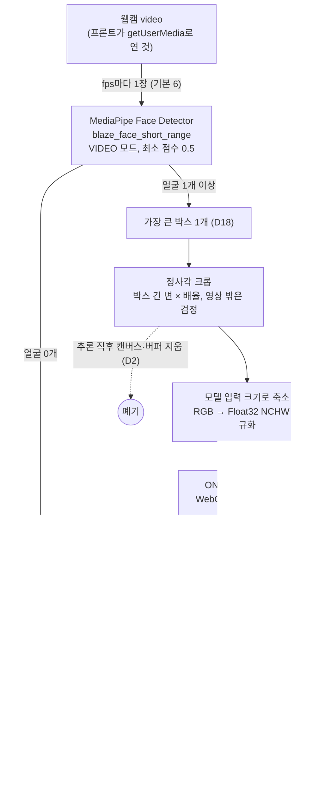
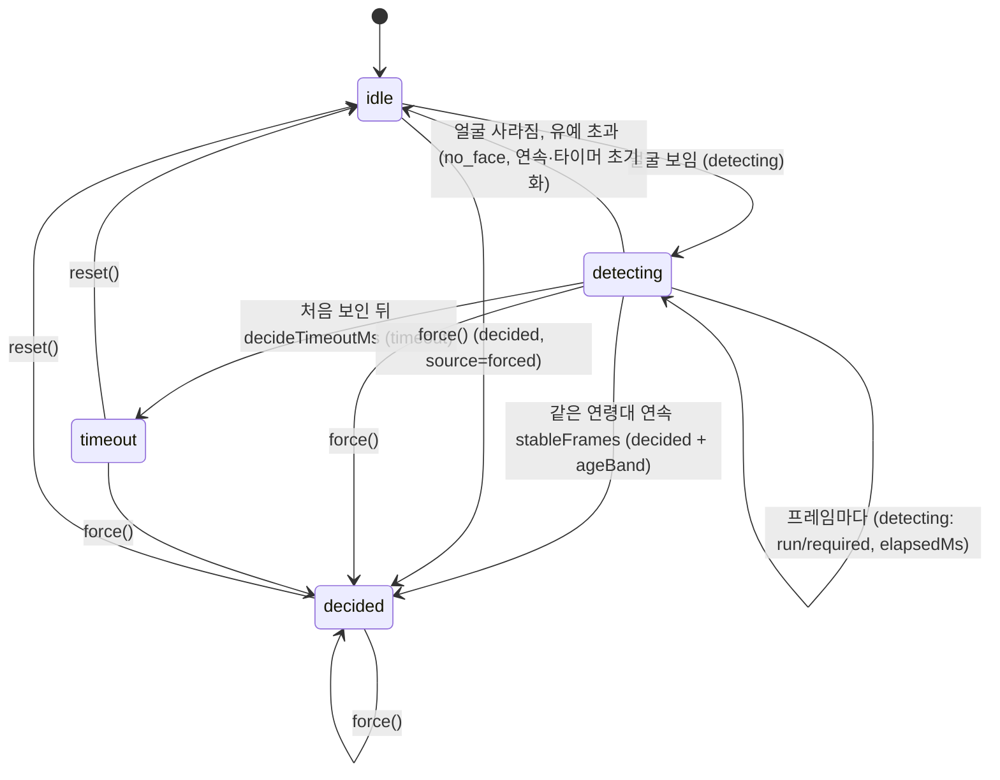

# AI 파이프라인 입출력 명세

- 작성: AI / 상태: v2 (2026-10-27, 연령대 3단계 ageBand 추가, D72)
- 공개 API는 [`docs/contracts/ai-output.md`](../../docs/contracts/ai-output.md)가 기준이다. 이 문서는 그 안에서 일어나는 일을 적는다.
- 관련 결정: D2, D3, D16, D18, D22, D27, D35

## 1. 전체 흐름



## 2. 입력 프레임

| 항목 | 값 |
|------|-----|
| 형식 | `HTMLVideoElement` (카메라 `MediaStream`이 붙은 것). 모듈은 카메라를 열거나 닫지 않는다 |
| 해상도 | 권장 1280×720, 최소 640×480. 모듈은 `videoWidth/videoHeight` 그대로 쓴다 |
| 준비 조건 | `readyState >= 2`이고 크기가 0보다 클 때만 처리. 아니면 그 주기는 건너뜀 |
| 처리 주기 | `1000 / fps` ms마다. 추론이 더 오래 걸리면 끝나는 즉시 다음 프레임 (밀린 프레임을 쌓지 않음) |
| 확정 뒤 | `decided`·`timeout` 이후 `reset()` 전까지 검출·추론을 하지 않는다 |

## 3. 얼굴 검출

| 항목 | 값 |
|------|-----|
| 모델 | `blaze_face_short_range.tflite` (float16, 2m 이내 얼굴용, 0.2MB) |
| 실행 | `@mediapipe/tasks-vision` `FaceDetector`, `runningMode: 'VIDEO'`, GPU(WebGL) 위임 → 실패하면 CPU |
| 출력 | 얼굴마다 박스(영상 픽셀 좌표 `x, y, width, height`)와 점수(0~1) |
| 선택 | 박스 면적이 가장 큰 1개만 나이 추정. 나머지는 버림 |
| 준비 실행 | 로드 때 빈 320×240 캔버스로 한 번 검출 (첫 검출의 셰이더 준비 2~3초를 손님이 오기 전에 흡수) |

## 4. 전처리

```
side   = max(box.width, box.height) × cropScale
crop   = 박스 중심에 맞춘 side × side 정사각형 (영상 밖은 검정으로 채움)
resize = inputSize × inputSize (캔버스 drawImage, 쌍선형)
x[c]   = (pixel[c] × scale − mean[c]) / std[c]     c = R, G, B
tensor = Float32 [1, 3, inputSize, inputSize] (NCHW)
```

| 후보 | 입력 이름 | inputSize | cropScale | scale | mean | std |
|------|-----------|-----------|-----------|-------|------|-----|
| InsightFace genderage | `data` | 96 | 1.5 | 1 | 0, 0, 0 | 1, 1, 1 (모델 안에서 정규화) |
| ViT age-gender | `pixel_values` | 224 | 1.3 | 1/255 | 0.485, 0.456, 0.406 | 0.229, 0.224, 0.225 |

- 파일 이름은 `age_estimator.onnx` 하나로 고정이고, 어떤 후보인지는 **ONNX 입력 이름**으로 알아낸다 (`findAgeModel`). 모델을 바꿀 때 코드 수정이 필요 없다.
- 크롭 배율은 평가([`model-comparison.md`](model-comparison.md))로 정했다.

## 5. 모델 출력과 후처리

| 후보 | 출력 텐서 | 나이 |
|------|-----------|------|
| InsightFace genderage | `fc1` [1, 3] = [여, 남, 나이/100] | `out[2] × 100` |
| ViT age-gender | `logits` [1, 2] = [나이, 성별 확률] | `out[0]` |

```
frameGroup = age >= seniorAge(55) ? 'senior' : 'non_senior'
ageBand    = senior ? '55plus' : (median(확정 프레임 나이) < bandEdges[0](35) ? 'under35' : '35to54')   // v2, 확정 때 한 번
confidence = detectionScore × min(1, 얼굴 폭 px / 80)
```

- **신뢰도 정의 (ai-output v1.1, PM 승인)**: 프레임 신뢰도 = 검출 점수 × min(1, 얼굴 폭 px / 80), `decided.confidence` = 확정에 쓴 연속 프레임 신뢰도의 평균.
- 나이 모델은 불확실도를 주지 않으므로 **신뢰도는 검출 점수와 얼굴 크기**로 만든다. 멀리 지나가는 사람(얼굴 폭 80px 미만)은 신뢰도가 낮아져 판정에 쓰이지 않는다.
- 나이 숫자는 `FaceObservation.age`로 리듀서에만 들어가고 이벤트에는 나가지 않는다 (테스트로 고정).

## 6. 판정 → 이벤트 (`ageGateReducer`)



| 규칙 | 값 / 동작 |
|------|-----------|
| 프레임 버림 | `confidence < minConfidence`(0.7)이거나 나이가 숫자가 아니면 `frameGroup: 'low_confidence'`, 연속 기록 0 |
| 연속 | 같은 연령대면 +1, 바뀌면 1부터 |
| 확정 | `run >= stableFrames`(5) → `decided`, `confidence` = 연속 프레임 신뢰도 평균 (소수 셋째 자리) |
| 타임아웃 | 얼굴이 처음 보인 시각부터 `decideTimeoutMs`(8000) 이상이고 확정이 안 됐으면 `timeout`. 같은 프레임에서 확정 조건도 맞으면 확정 |
| no_face | 얼굴이 있다가 없어지면 1번. 대기 중 계속 없으면 이벤트 없음 |
| 깜빡임 유예 | `noFaceGraceMs`(기본 0). 얼굴이 마지막으로 보인 뒤 이 시간 안의 빈 프레임은 무시하고(이벤트 없음) 연속 기록을 유지한다. 타임아웃 시간은 계속 흐른다. 0이면 계약 v1과 같이 한 프레임만 빠져도 no_face. 실측 후 값을 정한다 |
| 고정 | `decided`·`timeout` 뒤에는 `reset()` 전까지 모든 프레임 무시 (D18) |
| force | 언제든 즉시 `decided(source: 'forced', confidence: 1)`. v2: `force('55plus' \| '35to54' \| 'under35')`, v1 값 `'senior'`→55plus, `'non_senior'`→35to54. 단축키 Shift+S/N/Y (v2-changes 2장) |
| ageBand (v2) | `group`이 senior면 항상 `55plus`. non_senior면 **확정에 쓴 연속 프레임들의 추정 나이 중앙값**이 `bandEdges[0]`(35) 미만이면 `under35`, 아니면 `35to54`. 그래서 `group === 'senior'` ⇔ `ageBand === '55plus'`가 항상 성립한다 (무작위 300회 테스트로 고정) |
| bandEdges (v2) | 기본 `[35, 55]`. `seniorAge`를 따로 주지 않으면 `bandEdges[1]`이 55세 기준이다. 순서가 틀리거나 숫자가 아니면 기본값을 쓴다 |
| error | 추론 예외가 연속되는 동안 첫 번째만 `error(inference_failed)`. 루프는 계속. 프론트는 판정 전 error를 timeout과 같이 처리 (kiosk-flow v1.1) |

## 7. 지연 시간

| 구간 | 목표 | Mac 실측 (Chromium, WebGPU) |
|------|------|-----------------------------|
| 로드 (`createAgeGate`) | 앱 시작 때 1회, 3초 이내 | InsightFace 0.8초 / ViT 약 1.1초 (준비 실행 포함) |
| 프레임 1장 (검출 + 나이) | 100ms 이내 | InsightFace 2ms / ViT 53ms (나이 모델만) |
| 얼굴이 보인 뒤 확정 | **2초 이내** | 0.67초 (6fps × 5프레임, 사진 영상) |
| 확정 못 하면 | 8초에 `timeout` | 리듀서 테스트로 고정 |

WASM(CPU) 1스레드에서 ViT는 프레임당 약 1.2초라 6fps가 나오지 않는다. 자세한 내용과 gram 대책은 [`model-comparison.md`](model-comparison.md).

## 8. 개인정보 (D2)
- 프레임은 크롭용 캔버스 1개에 그렸다가 추론 직후 `clearRect`, 입력 버퍼는 0으로 덮는다.
- 저장, `console.log`, 서버 전송 없음. 데모 페이지도 나이 숫자를 보여 주지 않는다.

## 9. 연령대 3단계의 정확도 한계 (v2, D72)
- 35세 경계는 확정 규칙(연속 프레임)과 별도로, 이미 non_senior로 확정된 프레임들의 중앙값으로만 나눈다. 35세 근처에서는 under35와 35to54가 섞여 나올 수 있다.
- 후보 B의 AgeDB 오차(MAE) 7.7세를 보면, 30~40세 손님의 연령대는 자주 틀릴 수 있다. 연령대는 추천 순서에만 조금 쓰이고(W_age, questions-v2.md), 화면 모드(쉬운/일반)는 지금처럼 55세 기준 `group`으로 정한다.
