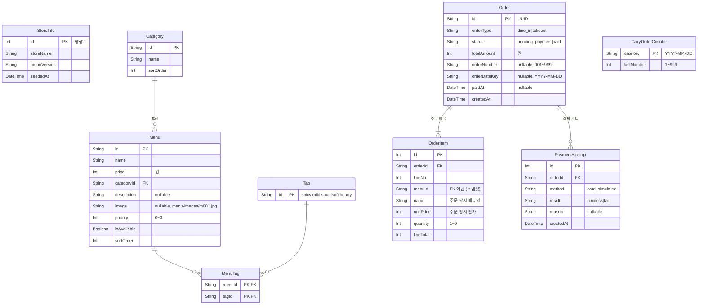

# MenuMate DB ERD

- 작성: Backend / 상태: v1 (2026-10-24)
- 기준: `docs/00_pm_decisions.md` (D2, D6, D13, D26, D36, D43, D47), `docs/contracts/menu-schema.md`, `docs/contracts/api.md`
- 실제 정의: [`backend/prisma/schema.prisma`](../prisma/schema.prisma), 변경 이력은 `backend/prisma/migrations/`

## 원칙
- **얼굴 이미지, 추정 나이, 임베딩, 연령대(55세 이상/미만)는 어떤 테이블에도 없다** (D2, D47).
- 금액은 원 단위 정수(`Int`). 부동소수점 컬럼 없음.
- SQLite 전용 기능을 쓰지 않는다. 상태 값은 enum 대신 문자열로 두고 서버 코드에서 검증한다. 나중에 PostgreSQL로 바꿀 때 `provider`와 `DATABASE_URL`만 바꾼다 (D36).
- 메뉴 옵션(맵기, 추가 메뉴)은 범위 밖이라 테이블이 없다 (D26).

## 다이어그램

## 테이블 설명

| 테이블 | 하는 일 | 채우는 곳 |
|--------|---------|-----------|
| `StoreInfo` | 메뉴 JSON의 `storeName`, `version`과 시드 시각. 행은 `id=1` 하나 | 시드 |
| `Category` | 메뉴 카테고리. `sortOrder` 작은 값이 먼저 | 시드 |
| `Menu` | 메뉴. `price`는 원 단위 정수, `priority`는 관리자 우선 추천 가중치(D6, 0~3), `isAvailable=false`는 품절(메뉴판·추천·주문 제외). `image`는 `MENU_IMAGE_DIR` 기준 상대 경로이고 API에서는 `/static/` + `image`로 내보낸다 | 시드 |
| `Tag` | 고정 태그 5개. 추천 점수(`questions.md`)가 이 태그만 쓴다 | 시드 (upsert) |
| `MenuTag` | 메뉴-태그 연결 (다대다) | 시드 |
| `Order` | 주문. 매장/포장, 상태, 서버가 계산한 총액. 결제 성공 시 `orderNumber`, `orderDateKey`, `paidAt`을 채운다 | `POST /api/orders`, 결제 |
| `OrderItem` | 주문 항목. 같은 메뉴는 한 줄로 합친다. 메뉴명과 단가를 주문 당시 값으로 복사해 둔다 | `POST /api/orders` |
| `PaymentAttempt` | 결제 시도마다 한 줄 (성공/실패, 실패 사유, 시각). 실패해도 주문은 `pending_payment`로 남고 다시 결제할 수 있다 | 결제 |
| `DailyOrderCounter` | 날짜별 마지막 주문번호. 결제 성공 시 같은 트랜잭션에서 1 올리고 `999` 다음은 `1`. DB에 있으므로 서버를 다시 켜도 그날 번호가 이어진다 (D43) | 결제 |

## 설계 메모
- **`OrderItem.menuId`에 FK를 걸지 않는다.** 우루루 실데이터로 메뉴를 다시 시드하면(D33) 메뉴 행이 바뀌는데, 지난 주문이 시드를 막거나 함께 지워지면 안 되기 때문이다. 대신 이름과 단가를 복사해 둔다.
- **시드는 메뉴 쪽 테이블(`StoreInfo`, `Category`, `Menu`, `MenuTag`, `Tag`)만 한 트랜잭션에서 바꾼다.** 검증에 실패하면 DB를 전혀 건드리지 않는다. 주문·결제·주문번호 테이블은 건드리지 않는다.
- **주문번호 날짜(`orderDateKey`)는 서버 `TZ`(기본 `Asia/Seoul`) 기준 로컬 날짜**다. 같은 번호가 다른 날 다시 나올 수 있으므로 `orderNumber`에는 unique 제약이 없다.
- 결제 동시 요청은 `status = pending_payment`인 주문만 `paid`로 바꾸는 조건부 업데이트로 막는다. 먼저 바꾼 요청만 주문번호를 받고, 나머지는 `ORDER_ALREADY_PAID`.
