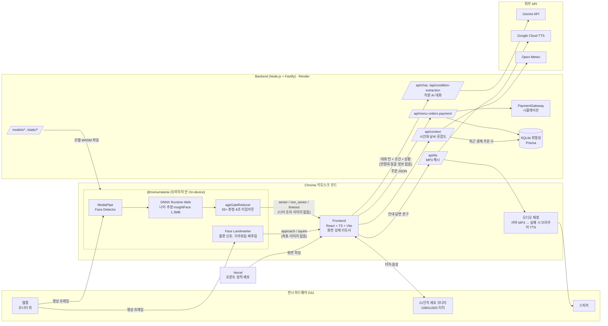

# 시스템 아키텍처

- 작성: Frontend, Backend, AI 공동 / 승인: PM
- 상태: v2 (2026-11-02, D90~D96 반영)
- 관련 결정: D2, D22, D27, D31, D34, D35, D90, D91, D92, D93, D94, D96

## 1. 전체 구성

온라인으로 동작한다 (D90). 얼굴 판정은 여전히 브라우저 안에서만 하고(D2), 대화·음성·날씨는 서버가 외부 API를 부른다. 배포는 프론트 Vercel + 백엔드 Render (D96). 노트북 한 대에서도 같은 구성으로 돈다.



## 2. 데이터 흐름과 개인정보 경계 (D2)

| 데이터 | 생기는 곳 | 가는 곳 | 저장 |
|--------|-----------|---------|------|
| 카메라 프레임 | 브라우저 video | `@menumate/ai` 내부 | **안 함** (추론 후 폐기) |
| 추정 나이 숫자 | `@menumate/ai` 내부 | 모듈 밖으로 안 나감 | **안 함** |
| 연령대 (senior/non_senior) | `@menumate/ai` | Frontend 상태 | 세션 메모리. 초기화 시 삭제. 서버로 안 보냄 |
| 불편 신호 (approach/squint, D94) | `@menumate/ai` 내부 (랜드마크·블렌드셰이프는 밖으로 안 나감) | Frontend 상태 → "큰 글씨" 제안 팝업 | **안 함**. 서버로 안 보냄 |
| 손님 발화·대화 턴 (D91) | 브라우저 음성 인식 | `POST /api/chat` → Gemini API | 서버 **저장·로그 안 함**. 세션 메모리만. Google 측 처리는 Gemini API 약관을 따름 |
| 안내·답변 문장 (D92) | Frontend | `POST /api/tts` → Google Cloud TTS | 서버 메모리 캐시(문장 해시, 최대 200개). 개인정보 없음 |
| 시간대·날씨·혼잡도 (D93) | Backend (Open-Meteo, 주문 수 집계) | Frontend | **안 함** |
| 취향 답변 (구 질문 5개 흐름) | Frontend | `POST /api/recommendations` | **안 함** (계산만). 현재 화면은 쓰지 않음 (D86) |
| 주문·결제 결과 | Backend | SQLite | 저장 (메뉴, 수량, 금액, 매장/포장, 주문번호). **Render 무료는 휘발성**: 재시작 때 사라짐 (D96) |

## 3. 폴더 구조 (npm workspaces)

```
MenuMate_V.2.0.0/
  package.json          workspaces: frontend, backend, ai
  docs/                 PM 문서, 계약, 이 문서
    contracts/          menu-schema, api, ai-output, questions, kiosk-flow
  frontend/             Vite React 앱 (@menumate/frontend)
    prototype/          버려질 프로토타입
  backend/              Fastify 서버 (@menumate/backend)
    prisma/  seed/  data/(git 제외)
  ai/                   브라우저 추론 라이브러리 (@menumate/ai)
    src/  models/(git 제외)  MODELS.md
```

- `ai`는 빌드하지 않고 TypeScript 소스를 그대로 export한다. 프론트의 Vite가 함께 번들한다.
- 각 역할은 **자기 폴더만** 고친다. 루트 `package.json`이나 `docs/contracts/`를 고칠 때는 PM 승인을 받는다.
- 루트 `package-lock.json`은 세 브랜치에서 서로 충돌하므로 **각자 브랜치에서는 커밋하지 않는다.** 통합할 때 PM이 한 번 생성해 커밋한다.

## 4. 실행 방법

| 상황 | 명령 | 접속 |
|------|------|------|
| 개발 | `npm run dev -w backend` + `npm run dev -w frontend` | `http://localhost:3000` (Vite가 `/api`, `/static`, `/models`를 `:4000`으로 프록시) |
| 전시 (단일 실행) | `npm run build -w frontend` 후 `npm run start -w backend` | `http://localhost:4000` |
| 키오스크 화면 | Chrome `--kiosk --app=http://localhost:4000` | |

- 카메라는 보안 컨텍스트가 필요한데, `localhost`는 HTTPS 없이도 허용된다.
- Chrome에서 카메라 권한을 한 번 허용해 두면 전시 중 다시 묻지 않는다. 리허설 때 확인한다.

## 5. 역할 간 연결 지점

| 연결 | 계약 | 주관 |
|------|------|------|
| Frontend ↔ Backend | `contracts/api.md` | Backend |
| Frontend ↔ AI | `contracts/ai-output.md` | AI |
| 메뉴 데이터 | `contracts/menu-schema.md` | Backend |
| 질문·추천 점수 | `contracts/questions.md` | AI (계산 구현은 Backend) |
| 화면 흐름 | `contracts/kiosk-flow.md` | Frontend |

## 6. 통합 일정
- 10/24~10/26: 각자 브랜치에서 계약 기준으로 개발. 상대 쪽은 계약대로 만든 가짜 구현(mock)으로 대신한다.
- 10/26(월) 저녁: 세 브랜치를 합쳐 실제로 연결.
- 10/27(화): 최종 점검 (D29).
